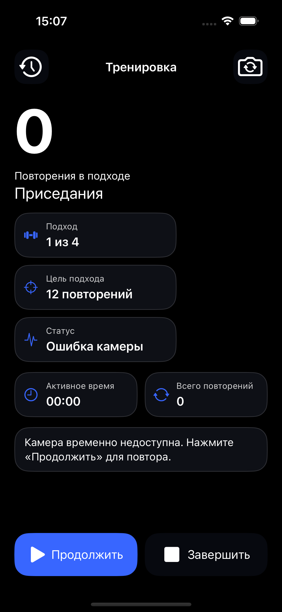
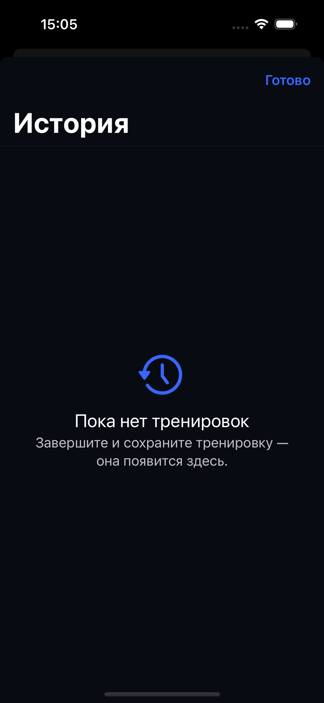
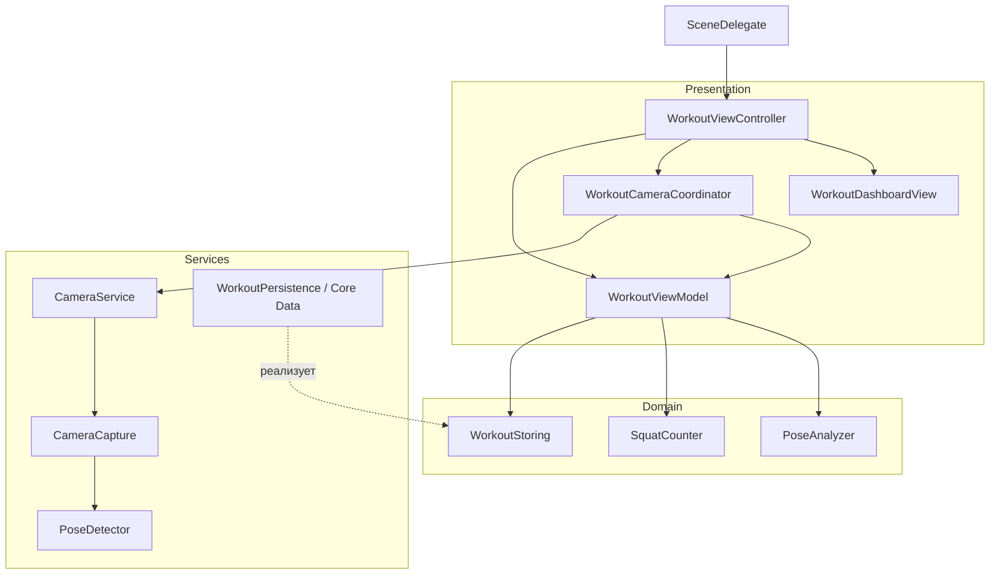

# RepsCounter

iOS-приложение для подсчёта приседаний: распознаёт суставы через Vision, рисует скелет и сохраняет итоги тренировок.

**In Development / Portfolio Preview** · iPhone · UIKit · MVVM · iOS 17.0 deployment target

Приложение проверялось на физическом **iPhone 15 Pro**. Точность подсчёта не подтверждена: ошибочное засчитывание неполного приседа [FP-001 / Issue №8](https://github.com/Alexander6Shevtsov/RepsCounter/issues/8) остаётся открытой проблемой.

## Демонстрация интерфейса

RepsCounter работает на физическом **iPhone 15 Pro**: вручную проверены камера, наложение 2D-скелета, счётчик, завершение тренировки и история. Скриншоты активной тренировки с камеры пока **не опубликованы**; демонстрационные материалы будут добавлены позднее. [Реестр изображений](Docs/SCREENSHOTS.md).

Скриншоты интерфейса в симуляторе (без работающей камеры)

Ниже — настоящие изображения **Release-сборки в iPhone 15 Pro Simulator / iOS 18.6**. Они демонстрируют оформление интерфейса, но не распознавание человека.

| Тренировка · камера недоступна | История · пустое состояние |
|:---:|:---:|
|  |  |

Первоначальный дизайн-концепт

`Docs/Concept.png` — исходный дизайн-концепт, а не скриншот приложения. Часть изображённых функций пока не реализована.

## Реализованные возможности

- Предпросмотр камеры, переключение фронтальной и основной камер, 2D-скелет поверх видео.
- Подсчёт приседаний; фиксированная тренировка: 4 подхода по 12 повторений, отдых 60 секунд.
- Повторения подхода, общий счёт, активное время, пауза, продолжение и завершение.
- Пауза при уходе в фон, прерывании или ошибке камеры; явное продолжение после возврата.
- Локальная история, ошибки чтения и повтор сохранения.
- Программная вёрстка, Dynamic Type, Debug-панель углов и счётчика.

Обработка локальная, фото и видео не сохраняются и не отправляются. В Core Data — UUID, дата, длительность, повторения и подходы.

## Технологический стек

| Область | Реализация |
|---|---|
| Язык | Swift, language mode 5 |
| Интерфейс | UIKit, Auto Layout, Dynamic Type, CAShapeLayer |
| Камера и поза | AVFoundation, Vision: VNDetectHumanBodyPoseRequest |
| Архитектура | MVVM, Dependency Injection через инициализаторы |
| Конкурентность | Swift Concurrency: actor, MainActor, Task, AsyncStream; последовательные очереди |
| Данные | Core Data, программная модель, SQLite |
| Проверки | XCTest: геометрия, подсчёт, время, камера, хранение и UIKit |

## Архитектура и разделение ответственности

Основные зависимости; пунктир — реализация протокола. Между `CameraCapture` и `PoseDetector` работает `CameraFrameProcessor`.

**Presentation.** Контроллер связывает UI, preview и скелет; `WorkoutDashboardView` отображает состояние. `WorkoutCameraCoordinator` согласует камеру с жизненным циклом, `WorkoutViewModel` управляет тренировкой, временем и сохранением.

**Domain.** `PoseAnalyzer` проверяет и сглаживает измерения; `SquatCounter` реализует автомат. Итог тренировки, `WorkoutStoring` и `WorkoutTimeSource` также находятся здесь. Подсчёт не зависит от UIKit, Vision и Core Data.

**Services и DI.** `SceneDelegate` собирает зависимости. ViewModel и история получают общий `WorkoutStoring`; время внедряется через `WorkoutTimeSource`. `CameraService` принимает `CameraAuthorizing` и `CameraCapturing`. Подмены проверяют ошибки и время без камеры и ожиданий. Анализатор и счётчик — конкретные компоненты Domain.

Подробнее: [архитектура](Docs/ARCHITECTURE.md), [камера и конкурентность](Docs/CAMERA_LIFECYCLE.md), [хранение](Docs/PERSISTENCE.md).

## Ключевые технические решения

- **AVFoundation → Vision.** Кадры `AVCaptureVideoDataOutput` обрабатываются последовательно вне UI, интервал — от 80 мс. Vision возвращает `BodyPose`; `AsyncStream` удерживает последнее наблюдение.
- **Скелет и углы.** `PoseOverlayView` рисует `CAShapeLayer` с учётом поворота, aspect fill и зеркальности preview. Угол hip–knee–ankle учитывает пропорции изображения; вырожденные векторы отклоняются.
- **Фильтрация и автомат.** Нога выбирается по confidence и удерживается, пока допустима. EMA сглаживает угол. Три raw-наблюдения подряд и текущая EMA подтверждают цикл: поиск стойки → стойка → нижняя фаза → стойка. Пороги 105°/160° экспериментальны и не доказывают физическую глубину.
- **Изоляция камеры.** `CameraCapture` — actor с последовательным executor вне MainActor. UI и тренировка работают на MainActor. Поколение, порядок и возраст исключают устаревшие наблюдения; потеря измерения или смена ноги сбрасывает движение.
- **Жизненный цикл.** Тренировка ожидает готовности камеры. Фон и прерывания останавливают захват и ставят паузу. Возврат требует «Продолжить»; смена камеры сохраняет повторения и прежнее состояние паузы.
- **Сохранение без дублей.** При ошибке повторно сохраняется итог с прежним UUID. Отдельные контексты, rollback и проверка UUID исключают дубли в одном процессе. Успех и история отражают записанные данные. Реализована миграция прежней SQLite-модели.
- **Монотонное время.** `ContinuousClock` измеряет длительность с отдыхом без пауз; `Date` задаёт дату начала. Пауза замораживает отдых. Отменяемая Task обновляет UI; продолжение требует новой стойки.

## Тестирование и качество

Результаты локальных прогонов из [отчёта PR №10](Docs/PORTFOLIO_UI.md#проверки), Xcode 27.1 / SDK 27.1. GitHub Actions CI для XCTest в репозитории не настроен.

| Среда | Результат |
|---|---|
| Debug, Simulator: iOS 18.6 / 26.5 / 27.0 / 27.1 | На каждой версии: 214 тестов — 213 passed + 1 expected failure FP-001 |
| Debug, физический iPhone 15 Pro / iOS 27.2 | 214 тестов — 213 passed + 1 expected failure FP-001 |
| Release, Simulator: iOS 18.6 | 207 тестов — 206 passed + 1 expected failure FP-001 |

Везде — 0 неожиданных ошибок и 0 пропусков. Debug/Release с полной проверкой конкурентности и диагностическая сборка Swift 6 успешны; язык проекта остаётся в режиме 5.

**FP-001 не устранена.** Строгий `XCTExpectFailure` фиксирует расхождение с ручной разметкой неполного приседа. Прогон с ожидаемой ошибкой не подтверждает точность распознавания.

Покрыты геометрия, автомат, время, гонки камеры, миграция и повтор записи. UIKit проверен на синтетических данных: 3 размера экрана × 12 категорий Dynamic Type. [Подробности теста](Docs/DYNAMIC_TYPE_TESTING.md).

**Ручная проверка:** на физическом iPhone 15 Pro проверены запуск, наложение скелета на изображение камеры, отображение показателей после редизайна, подсчёт, завершение и история. Длительная плавность, нагрев и точность распознавания требуют отдельных испытаний. Детали UI — в [документации редизайна](Docs/PORTFOLIO_UI.md).

## Как запустить проект

1. Скачайте **Code → Download ZIP**, откройте `RepsCounter.xcodeproj`. Проверенная среда — **Xcode 27.1**.
2. Выберите схему **RepsCounter**, подключённый iPhone и свою Team в **Signing & Capabilities**.
3. Запустите приложение, разрешите камеру. Для распознавания требуется физический iPhone; Simulator подходит для интерфейса и XCTest.
4. Закрепите телефон вертикально, встаньте боком: таз, колени и голеностопы должны быть в кадре. Выпрямитесь, выполните движение и вернитесь в стойку.

Deployment target — **iOS 17.0**; запуск на iOS 17 не подтверждён: runtime отсутствует. Сторонние зависимости не нужны.

## Известные ограничения и дальнейшее развитие

- 2D-угол не гарантирует оценку глубины при любом ракурсе; [FP-001](Docs/SQUAT_DEPTH_VALIDATION.md) приоритетна. Далее — сравнение с независимой ручной разметкой.
- Vision 3D исследуется в открытом [PR №9](https://github.com/Alexander6Shevtsov/RepsCounter/pull/9) и **не входит в main**.
- Реализованы приседания, фиксированные цели и портретный интерфейс iPhone. Настройки, вспышка, звук, автозапуск, профиль, другие упражнения, планы и графики пока отсутствуют.
- Несохранённый итог доступен для повтора в текущем процессе; восстановление после принудительного закрытия не реализовано.
- Предстоят аппаратные проверки совмещения скелета на обеих камерах, доступности, производительности и совместимости с iOS 17.

## Автор и лицензия

[Александр Шевцов](https://github.com/Alexander6Shevtsov) · Junior iOS Developer. Лицензия [MIT](LICENSE).
