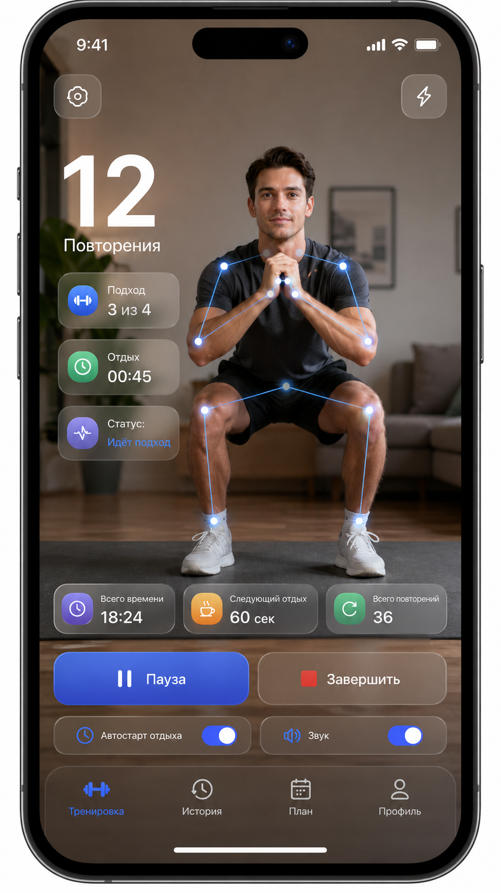
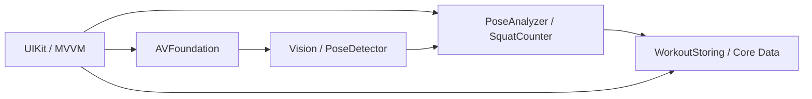

# RepsCounter

**iOS-приложение для подсчёта приседаний с помощью камеры и распознавания позы человека.**

`Swift` · `UIKit` · `Vision` · `AVFoundation` · `Core Data` · **iOS 17+**

**Статус:** In Development · Portfolio Project

## О проекте

RepsCounter анализирует изображение с камеры iPhone, определяет положение суставов и отображает скелет поверх видео. На основе изменения углов ног приложение отслеживает приседания, показывает ход тренировки и сохраняет результаты.

Обработка видеопотока выполняется непосредственно на устройстве — без отправки или сохранения видео.

## Концепт дизайна

Визуальная идея RepsCounter: камера на весь экран, акцент на счётчике повторений, синий скелет и полупрозрачные панели тренировки. **Это дизайн-концепт; отдельные элементы могут отличаться от текущей версии приложения.**

  

## Возможности

- **Распознавание позы:** скелет человека в реальном времени на изображении камеры.
- **Подсчёт повторений:** анализ углов колена, сглаживание измерений и автомат состояний движения.
- **Тренировка:** текущий и общий счёт повторений, подходы, цель, активное время и отдых.
- **Управление:** пауза, продолжение, завершение и переключение фронтальной/основной камер.
- **История:** сохранение тренировок в Core Data и просмотр результатов.
- **Интерфейс:** UIKit, адаптивная вёрстка, Dynamic Type и полупрозрачные панели поверх камеры.

## Технологии

| Направление | Технологии |
|---|---|
| Язык и UI | Swift, UIKit, Auto Layout |
| Компьютерное зрение | Vision, 2D Human Body Pose |
| Камера | AVFoundation |
| Архитектура | MVVM, Dependency Injection |
| Конкурентность | Swift Concurrency, actor, MainActor, AsyncStream |
| Хранение | Core Data, SQLite |
| Инструменты качества | XCTest |

## Архитектура

Код разделён на **Presentation**, **Domain** и **Services**. Объекты собираются через Dependency Injection; логика подсчёта отделена от UIKit и Vision.

### Инженерные решения

- **Обработка кадров:** анализ позы вне главного потока, контроль актуальности результатов и жизненного цикла камеры.
- **Подсчёт:** фильтрация координат, EMA-сглаживание и конечный автомат фаз движения.
- **Сохранение:** устойчивые идентификаторы тренировок и безопасная повторная запись без дублирования.

Подробнее: [архитектура](Docs/ARCHITECTURE.md) · [камера и конкурентность](Docs/CAMERA_LIFECYCLE.md) · [хранение данных](Docs/PERSISTENCE.md).

## Запуск

1. Клонируйте репозиторий и откройте `RepsCounter.xcodeproj` в Xcode (проверенная версия — 27.1).
2. Выберите схему `RepsCounter`, подключите iPhone и настройте **Signing & Capabilities → Team**.
3. Запустите приложение, разрешите доступ к камере и разместите iPhone вертикально так, чтобы ноги целиком находились в кадре.

Для распознавания движений нужна камера физического iPhone. Сторонние библиотеки не требуются.

## Автор

[Александр Шевцов](https://github.com/Alexander6Shevtsov) · Junior iOS Developer

**Лицензия:** [MIT](LICENSE).
